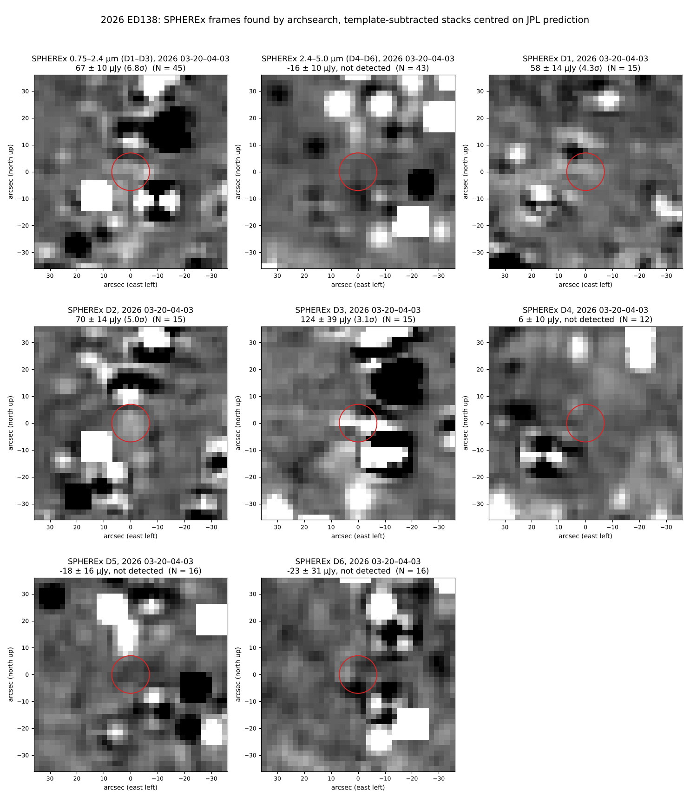

# 2026 ED138: SPHEREx stamps from archsearch frames



- **Frames:** `archsearch "2026 ED138" 2026-03-15 2026-04-10 --moving --services IRSA` found 116 SPHEREx frames (`archsearch_frames.csv`). 106 of them had enough reference frames for template subtraction.
- **Method:** the same as `../../../spherex-search` (`sx_get.py` cutouts plus `sx_stack.py` template subtraction).
  - Ephemeris: JPL Horizons, observer SPHEREx (`500@-163182`).
  - 7″ aperture, 15–30″ background annulus.
  - Stacks: 3σ-clipped mean of per-frame fluxes; the error is the scatter divided by √N.
- **Result:** detected at 0.75–2.4 µm, 67 ± 10 µJy (6.8σ, N = 45). This is consistent with the earlier 75 ± 11 µJy. Nothing is detected at 2.4–5 µm.
- **Caveat:** the D3 panel has a star-subtraction residual inside the aperture, so treat its 3.1σ value with caution.

Regenerate:

```
python build_grid.py
python ../../../.claude/skills/stamp-grid/make_stamp_grid.py stamp_grid.json
```

The cutouts themselves are not committed (~360 files). Re-download them with `spherex-search/scripts/sx_get.py`, setting `REG` to the 2026a pass only.
