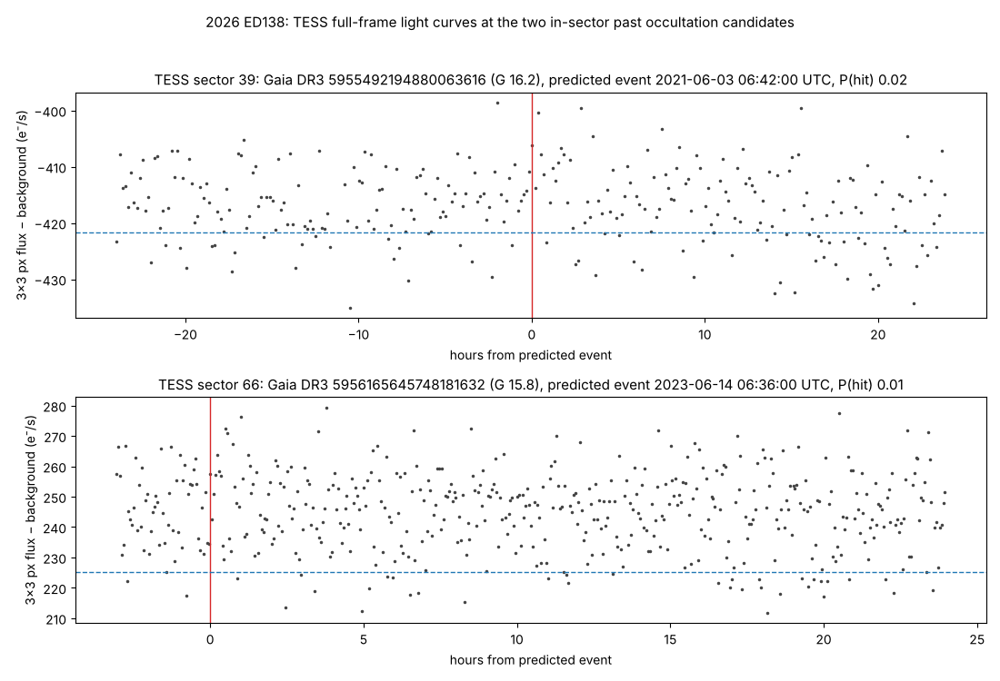

# 2026 ED138 — past stellar occultations, 1990–2026

**Result: no past occultation is likely to have been recorded by any telescope checked.**

## Search (`past_occultation_search.py`)
- Hourly JPL Horizons ephemerides (orbit solution 2026-10-29): geocentric 1990-01-01 → 2026-10-30, TESS-centric
  (`500@-95`) from 2018-07-25 (TESS's orbit shifts the object up to ~11″).
- Gaia DR3 stars G < 16.5 (one star list per year of track), propagated with proper motion; 1-minute time grid.
- Candidate if closest approach < (R_earth + 450 km)/Δ + 3σ (geocentric) or < 450 km/Δ + 3σ (TESS).
- 540 candidates (`past_candidates_1990-2026.csv`): 509 geocentric (236 nominally on Earth), 31 TESS.
  3σ uncertainty is ~25,000 km in the 1990s and ~1,500–5,500 km after 2009, so older events are only statistical.

## TESS (`tess_sector_check.py`, `tess_lightcurves.py`)
- Only 2 TESS candidates fell inside an active sector: 2021-06-03 06:42 UTC (sector 39, G 16.2, P(hit) 0.02) and
  2023-06-14 06:36 UTC (sector 66, G 15.8, P(hit) 0.015). The best-placed events (2024-06-21, P 0.58; 2021-04-23,
  P 0.53) happened when TESS was not observing those stars.
- TESScut light curves (3×3 px): no dip at either predicted time (+1.5σ and +0.9σ). Even a hit would give at most
  0.75σ (600 s cadence) or 1.7σ (200 s cadence) because the ~37 s event is diluted and the stars are faint and blended.

## Pointing logs (`pointing_log_check.py`)
- 509 geocentric candidates vs 16,111 logged pointings/frames (Swift, XMM-Newton, Chandra, ROSAT, Suzaku, EXOSAT,
  XRISM, IXPE, and every WISE/NEOWISE and SPHEREx frame containing the object), with a time window covering the
  along-track uncertainty: **0 matches**.

## Bright-star events where the shadow almost certainly fell on Earth (unrecorded as far as known)

| UTC | G | P(shadow on Earth) | Max duration |
|---|---|---|---|
| 2009-10-23 18:02 | 12.0 | ~1.00 | 32 s |
| 2009-12-22 03:57 | 12.4 | ~1.00 | 27 s |
| 2013-11-23 09:48 | 12.3 | 0.93 | 27 s |
| 2015-12-06 23:38 | 12.8 | ~1.00 | 26 s |
| 2016-07-07 07:35 | 12.7 | ~1.00 | 39 s |
| 2018-08-30 13:55 | 13.0 | 0.99 | 76 s |

Not checked: ground surveys (ATLAS, ASAS-SN, DECam/VVV — no reachable per-exposure logs) and Gaia's own scans
(scanning-law tool not reachable).
