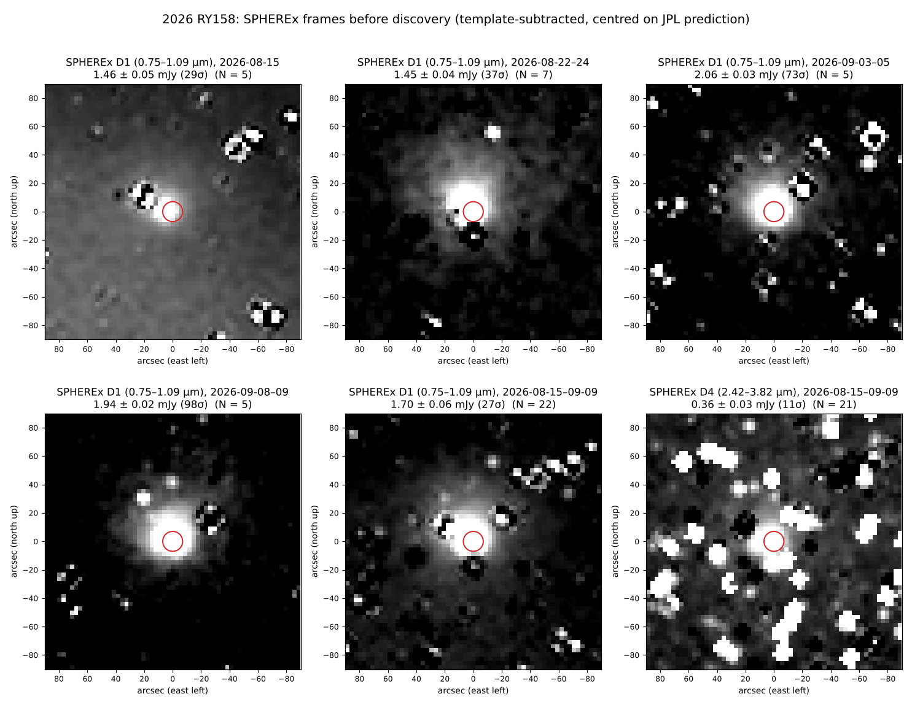

# 2026 RY158: SPHEREx frames before discovery



**Orbit** (JPL SBDB, copy of an MPC orbit): a ≈ 435 au, e = 0.975, q = 11.0 au, i = 95.5°, H = 4.06. The arc is only 11 days (2026-09-10 – 09-21, 19 observations), and the condition code is 7. The MPC API does not resolve the designation (2026-11-02), so neither astrometry nor a covariance is public. In Aug–Sep 2026 the object is at 13.6 au, V ≈ 15.8, RA ≈ 100–111°, Dec ≈ −69…−71°.

## Result

- **Frames:** `archsearch "2026 RY158" 2026-08-15 2026-11-01 --moving` found 22 SPHEREx QR3 exposures (D1 + D4) from 2026-08-15 to 09-09. They are listed in `data/archsearch_2026.csv`.
  - All 22 exposures fall 1–26 days *before* the first MPC observation.
  - MAST timed out. Swift returned only wide-field rows.
- **Detected in every D1 frame** at 1.4–2.1 mJy (7″ aperture).
  - In 19 of 22 frames, the brightest residual within 60″ is ≤ 10″ from the JPL prediction.
  - On 08-15, 26 days before the arc starts, the peak is about 6″ east of the prediction. The short-arc orbit already holds to about 1 SPHEREx pixel there.
  - These frames are precovery astrometry that would extend the arc.
- **D4 (2.4–3.8 µm):** the stack gives 0.36 ± 0.03 mJy, but single frames are dominated by star residuals (only 3 of 22 peaks are on target). Treat it as a tentative detection.
- **Caveats:**
  - D1 spans 0.75–1.09 µm across the detector. The jump from ~1.45 mJy (Aug) to ~2.0 mJy (Sep) can partly come from a different wavelength at the object's position, so it is not necessarily variability.
  - The source looks broader than the SPHEREx PSF in the deep stacks. That would be worth checking for a coma, since q = 11 au makes it a Centaur. It is not tested here.
  - The quoted flux is aperture flux, not total flux.

## Method

- `scripts/sx_get.py` downloads 0.12° cutouts for each science frame, plus up to 10 same-band reference frames of the same sky taken ≥ 2 days away. Positions come from Horizons with observer SPHEREx (`500@-163182`, `data/eph_sx.txt`).
- `scripts/sx_stack.py` builds the stamps and photometry:
  - Each frame is resampled to a north-up 3″ grid, and the median reference is subtracted.
  - Photometry uses a 7″ aperture and a 15–30″ background annulus. Per-frame noise comes from 12 blank offset apertures.
  - Stacks are a 3σ-clipped mean. The error is the scatter divided by √N.
  - Outputs: `data/sx_phot.json` (per frame) and `data/sx_stamps.npz`.
- TESS also covers the predicted track in 14 sectors (2018–2025, V ≈ 16–18; `data/eph_geo.txt` + tess-point). Those epochs are a year or more outside the arc, so the position there is too uncertain to put a stamp on.

Regenerate:

```
python scripts/sx_get.py            # ~480 cutouts into sx/cut (not committed, ~12 MB)
python scripts/sx_stack.py
python ../.claude/skills/stamp-grid/make_stamp_grid.py stamp_grid.json
```

## Astrometry and ADES (not yet submitted)

- **Positions:** `scripts/sx_astrometry.py` fitted 17 D1 positions (2026-08-15 to 09-09).
  - Each is a Gaussian fit on the reference-subtracted image, tied per frame to 6–12 Gaia DR3 stars.
  - Uncertainties are 0.4–0.9″. Five frames were dropped because the object fit was below S/N 5.
  - Results are in `data/sx_astrometry.json`.
- **ADES file:** `scripts/write_ades.py` writes `data/2026RY158_sphrx_ades.xml`.
  - Station 288, with SPHEREx geocentric positions from Horizons (`data/sx_spacecraft_vec.txt`).
  - Filed under the tracklet label `RY158SX`. It validates against IAU-ADES `submit.xsd`.
- **Find_Orb check** (`data/findorb/`): run on these 17 positions alone (unperturbed, no JPL DE).
  - Mean residual 0.43″. Every residual is ≤ 1.0″ and within 1.7σ, so there are no outliers and the stated errors are realistic.
  - Resulting orbit: q = 11.06 ± 0.11 au, i = 95.44°, node 190.09°, peri 325.16°, perihelion 2031 Jan 2. JPL gives 11.04 au, 95.47°, 189.69°, 325.38°, 2031 Jan 15.
  - e is pinned near 1 because a 25-day arc can't constrain a.
- **Before submitting:** SPHEREx isn't on the MPC's SARC archive list, so the MPC should be contacted first (per their SARC page).
