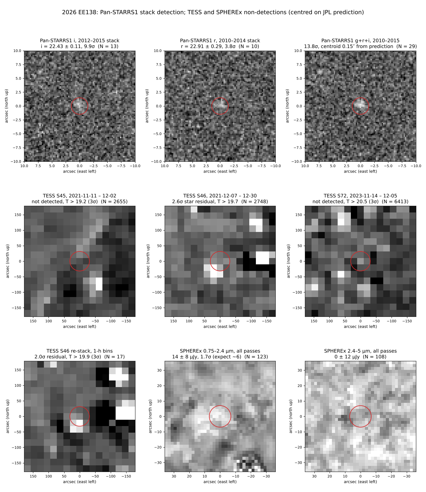

# 2026 EE138 — archival search (TESS, Gaia, Swift, SPHEREx, CHEOPS, Euclid, Subaru, SDSS, Pan-STARRS)

TNO, a = 71.1 au, e = 0.51, i = 11.2°, H = 3.95 (JPL SBDB, orbit soln 2026-10-27, arc 2013–2026).
Distance 72–77 au, V = 22.5–22.9 over 2014–2026. Track: RA 161.6–167.7°, Dec +7.0…+3.2°, b ≈ +54…+56°.
Astrometry: `data/2026EE138.obs` (DECam W84 2013–2020, Rubin X05 2026). Ephemeris: `data/eph_geo.txt` (Horizons, daily).

## Result

| Mission | Coverage | Expected brightness | Result |
|---|---|---|---|
| TESS | On silicon in 3 sectors (`scripts/tess_check.py`, tess-point, sectors 1–134; matches TESSCut) | V ≈ 22.7 (T ≈ 22.2) | Covered, not detectable in single FFIs; only a shift-stack could reach it, and it's at/below that limit |
| Gaia | Mission ran 2014-07-25 – 2025-01-15 | V 22.5–22.9 → G ≈ 22.3–22.7 | Not detectable (G limit ≈ 20.7). Not in `gaiadr3.sso_source` or `gaiafpr.sso_source` |
| Swift | HEASARC `swiftmastr`, 1,093 obs in RA 158–171°, Dec 1–9.5° | — | Never observed: closest 0.27° (UGC 5923, 2015-07-12), outside UVOT/XRT fields. No colours possible |
| CHEOPS | ESASky `mv_cheops_obs_fdw`, all 2,938 public visits (2020-02 – 2023-12) (`scripts/cheops_check.py`) | V ≈ 22.7, far beyond CHEOPS | Not observed: closest 2.4° (EE Leo, 2021-04-08). 2024–2026 unchecked (DACE down, HTTP 503) |
| Euclid | ESA `easidr` (DR1) and `eas` (Q1/Q2) `ivoa.obscore`; IRSA Euclid collections | V ≈ 22.7 (VIS would reach it) | Not observed: closest DR1 frame 11.3° from the track (COSMOS, RA 151.1°, Dec +2.8°); Q1/Q2 ≥ 77°; IRSA nothing within 25°. Track is at ecliptic latitude −0.7…−1.9°, which the Wide Survey avoids |
| **Pan-STARRS1** | 3π warps via ps1filenames/fitscut: 137 epochs 2009–2015, 113 warps contain the position, ~50 usable (rest in gaps) | V ≈ 22.8–22.9 | **Detected in shift-stack: g+r+i 13.8σ, i = 22.43 ± 0.11, r = 22.91 ± 0.29** — see below |
| SDSS | DR18 `Field` table, 8,149 fields; 2 runs contain the track | V ≈ 23.1 | 2002 run in a camcol gap; 2006-05-24 frame: g 3.2σ hint, r/i < 2σ. Not detected |
| **Subaru** | SMOKA, all instruments, 477,926 frames in 57 1° tiles along the 1999–2026 track (`scripts/smoka_tiles.py`, `scripts/smoka_check.py`) | V 22.7–23.1 | **Covered: 22 exposures (2004, 2016, 2020), expected S/N ~20–80 each. 2020 HSC-SSP has g, r, i, z, Y** — see below |
| SPHEREx | 292 L2 frames contain the object (QR2; Apr–Jun 2025, Dec 2025, May 2026) | z ≈ 21.9 AB → ~6 µJy | Not detected: 14 ± 8 µJy (0.75–2.4 µm), 0 ± 12 µJy (2.4–5 µm) |

### TESS sectors (`data/tess_coverage.txt`)

| Sector | Dates | Cam/CCD | Object position (mid) | Motion over sector |
|---|---|---|---|---|
| 45 | 2021-11-06 – 12-02 | 4/3 | 165.84°, +4.54° | ~21 px (near stationary point) |
| 46 | 2021-12-02 – 12-30 | 3/2 | 165.88°, +4.51° | ~7 px (stationary) |
| 72 | 2023-11-11 – 12-07 | 4/2 | 166.66°, +3.99° | ~21 px, col ≈ 158 (near CCD edge) |

### Shift-stacks — not detected (`scripts/tess_shiftstack.py`, `data/tess_shiftstack.json`)
Per sector: drop flagged and the brightest-sky 20% of frames, subtract each pixel's sector median, sample a
north-up 21″ stamp on the predicted track, clipped mean. Noise from 8 control tracks 12 px away.
Expected signal: T ≈ 22.2 → 0.19 e⁻/s.

| Sector | Frames | Flux (e⁻/s) | Control σ | 3σ limit |
|---|---|---|---|---|
| 45 | 2,655 | 0.18 | 1.05 | T > 19.2 |
| 46 | 2,748 | 1.73 | 0.66 | T > 19.7 (2.6σ bump = star residual) |
| 72 | 6,413 | 0.07 | 0.32 | T > 20.5 |

Best limit is ~1.7 mag short of the object. Noise is set by star residuals, not photon noise.

### Sector 46 re-stack (`scripts/tess_s46_deep.py`, `data/tess_s46_deep.json`)
S46 looked like the best chance (object near its stationary point), but it's the worst:
- The object loops within ~2 px (≈40″) for the first ~3 weeks and only moves off in the last ~6 days
  (6.3 px total). A sector-median template partly removes the object, and per-frame templates that
  exclude the object's position exist only for the last ~17 hours of usable data.
- A G = 12.5 star (Gaia DR3 3815098193520100224) passes 26″ (1.3 px) from the track at sector end, and a
  G = 14.8 star 37″ from it early on. A 10-mag-brighter star leaves residuals far above 0.19 e⁻/s.
- Re-stack (1-h bins, template from bins with the object ≥2 px away, bins within 60″ of the G = 12.5 star
  dropped): 1.09 ± 0.53 e⁻/s (2.0σ), reversed-motion null 0.2σ, T > 19.9 (3σ). The flux is ~6× what the
  object can give, so it's a residual, not the object.
- A cross-sector template (S72 sky at the S46 position) would avoid self-subtraction, but camera/PSF
  mismatch on the G = 12.5 star would still dominate. Not attempted.

## Pan-STARRS1 (`scripts/ps1_warps.py`, `scripts/ps1_warps_refine.py`, `scripts/ps1_stack.py`, `data/ps1_stack.json`)
- Warp list: `ps1filenames.py` along the track, then re-queried at the exact object position for each of the
  137 epochs (113 warps contain it; 24 epochs fall outside every skycell's exposure). 63 warps are blank (NaN)
  at the position (chip gaps / masks), leaving ~50.
- Stack: 60″ cutouts, nJy via `FPA.ZP` + `EXPTIME`, north-up 0.25″ grid on the JPL position, 3σ-clipped mean.
  1.5″ aperture (≈ total flux for ~1.2″ seeing), 6–10″ annulus; noise from 8 control positions 15″ away.

| Filter | Epochs | Dates | Flux (nJy) | S/N | AB mag | Median-stack S/N |
|---|---|---|---|---|---|---|
| g | 6 | 2011–2013 | 252 ± 524 | 0.5 | > 23.4 (3σ) | 0.9 |
| r | 10 | 2010–2014 | 2,498 ± 663 | 3.8 | 22.91 ± 0.29 | 3.6 |
| **i** | 13 | 2012–2015 | 3,885 ± 391 | **9.9** | **22.43 ± 0.11** | 10.2 |
| z | 9 | 2010–2013 | 3,624 ± 1,511 | 2.4 | 22.50 ± 0.46 | 2.5 |
| y | 14 | 2009–2015 | 2,802 ± 3,834 | 0.7 | > 21.3 (3σ) | 0.4 |
| **g+r+i** | 29 | 2010–2015 | 2,516 ± 183 | **13.8** | — | 13.2 |

- Checks: centroid 0.15–0.2″ from the JPL prediction; median stack agrees (not driven by one epoch);
  jackknife i 6.9σ (2012-02 – 2014-02) and 7.2σ (2014-02 – 2015-01). Static sources can't follow a
  track spread over 2.5° of sky and 5 years.
- Colours (PS1 system): r − i = 0.48 ± 0.31 (Rubin 0.26 — consistent at 0.7σ); i − z = −0.07 ± 0.47;
  g − r > 0.5 (consistent with DECam 0.58). Expected i ≈ 22.35 from Rubin/DECam — matches.
- Caveat: a stack gives average brightness and confirms the orbit back to ~2010, but no per-epoch astrometry
  for the MPC (single epochs are S/N ~2–3).

## SDSS (`scripts/sdss_check.py`, `scripts/sdss_forced.py`, `data/sdss_*.json`)
- SkyServer DR18 `Field` table, 8,149 fields in RA 154–170°, Dec 1–12°, matched at each field's r-band time
  (APO ephemeris, `data/eph_apo.txt`).
- Run 3518 camcol 4 field 121 (2002-12-07): object 12 px off the frame edge — in the gap between camcols.
- Run 6160 camcol 3 field 13 (2006-05-24, V ≈ 23.05, JPL 3σ 3.5″): no catalogued source within 12″.
  Forced 1.5″ aperture (noise from 200 empty-sky apertures): g 0.42 ± 0.13 nmgy (3.2σ, ≈ g 23.4 total; expected ≈ 23.4),
  r 1.5σ, i 1.3σ, z 0.3σ. A hint in g only; SDSS single-epoch depth (r ≈ 22.4 here) is just short.

## Subaru (`scripts/subaru_exposures.py`, `data/subaru_exposures.json`, `data/subaru_smoka.json`)
SMOKA lists one frame per CCD (HSC 112, Suprime-Cam 10), so 2,158 matching frames = 22 exposures.
Position = JPL at mid-exposure (Maunakea); offset = distance from pointing centre (HSC reach ~0.75°, Suprime-Cam ~0.28°).
Expected S/N uses DECam/Rubin colours and typical single-exposure depths (rough).

| Date (UT) | Instrument / programme | Filter × exp | Offset | JPL 3σ | Est. mag | Est. S/N |
|---|---|---|---|---|---|---|
| 2004-06-17 07:04–07:20 | Suprime-Cam, F43 (uh54ab) | VR × 3 × 60 s | 0.18° | 4.4″ | V ≈ 22.9 | ~24 |
| 2016-03-17 06:04–12:06 | HSC, C17_F04 (Jedicke) | r × 6 × 30 s | 0.14° | 0.5″ | r ≈ 22.5 | ~26 |
| 2020-01-19 – 01-30 | HSC-SSP Wide | z × 2, Y × 3, i × 4 (200 s) | 0.50–0.74° | 0.7″ | i ≈ 22.2 | 22–76 |
| 2020-02-19 – 02-25 | HSC-SSP Wide | z, g × 2 (150 s), r × 1 (150 s) | 0.36–0.48° | 0.6″ | g ≈ 23.0 | 49–77 |

- **Colours:** the 2020 HSC-SSP visits give g, r, i, z and Y within ~5 weeks — enough for g−r, r−i, i−z, z−Y
  on one photometric system, and the only route to z/Y colours found so far.
- **Precovery:** the 2004 Suprime-Cam frames would extend the arc back 9 years (current first obs 2013-04-01).
- **Caveats:** offsets > 0.7° (2020-01-28 Y, 2020-01-30 z) are at the HSC field edge and may fall off-chip or in a
  gap; CCD-level coverage is unchecked. Suprime-Cam chip coverage also unchecked (field rotation unknown).
- **Not downloaded:** SMOKA raw frames and HSC-SSP processed images need a (free) account, which this
  session doesn't have. Next step: fetch the CCDs at the listed positions and measure.

## Swift (`scripts/coverage_sx_swift.py`, `data/coverage_sx_swift.json`)
No pointing ever covered the object. Even if one had, V ≈ 22.7 is far below UVOT depth (the 2026 ED138 U-band
detection in `../uv-xray-atmosphere` was a ~4,800 s stack of a U ≈ 21 object). No Swift colour estimates.

## SPHEREx (`scripts/sx_get.py`, `scripts/sx_stack.py`, `data/sx_phot.json`)
- IRSA ObsCore: 292 frames contain the object at exposure mid-time (`data/coverage_sx_swift.json`); QR3 has none here yet.
- Method as in `../spherex-search`: 72″ north-up stamp per frame minus the median of ≤40 same-band, same-region
  frames with the object >30″ away; 7″ aperture, 15–30″ annulus; 6 control tracks 2′ away.
  882/898 cutouts downloaded (16 failed); 231 frames had enough templates.

| Stack | N | Flux (µJy) | Control scatter | Verdict |
|---|---|---|---|---|
| Apr–Jun 2025, 0.75–2.4 µm | 36 | 9.5 | 6.0 | 1.6σ |
| Dec 2025, 0.75–2.4 µm | 69 | 11.2 | 15.6 | <1σ |
| May 2026, 0.75–2.4 µm | 18 | 31.7 | 18.2 | 1.7σ |
| **All, 0.75–2.4 µm** | 123 | **13.7** | 8.0 | 1.7σ, not detected; 3σ < 24 µJy above zero |
| All, 2.4–5 µm | 108 | 0.4 | 12.1 | nothing |

Expected from Rubin/DECam z ≈ 21.9 AB: ~6 µJy at ~1 µm, i.e. ~0.8σ in the best stack. No colour/spectral constraint.

## Colours (from current obs)

| Source | Date | Colour |
|---|---|---|
| DECam | 2018-03-19 | g−r = 0.58 |
| Rubin | 2026-04-10 | r−i = 0.32 |
| Rubin | 2026-04-11 | r−i = 0.19 (2 pairs) |
| Rubin | 2026-04-14 | r−i = 0.18 |
| Rubin | 2026-04-16 | r−i = 0.33 |
| Rubin | 2026-06-26 | r−i = 0.33 |

Mean: g−r = 0.58, r−i = 0.26 (neutral / less-red class).
