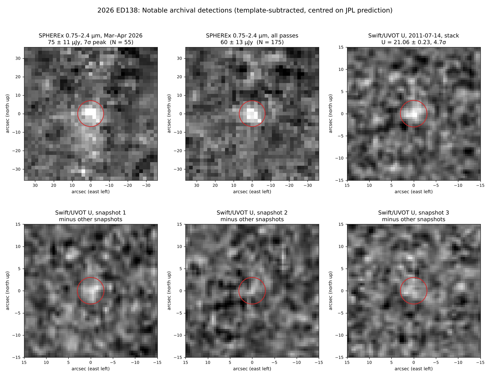

# 2026 ED138 — UV and X-ray archives, atmosphere and physical estimates

## Swift/UVOT U-band precovery (2011-07-14) — detected, 4.7σ
- Obsid 00031929004 (target IGR J16418−4532), U filter, three snapshots (1,614 + 1,558 + 1,616 s).
- JPL positions per snapshot (geocentric; Swift LEO parallax < 0.3″), 3σ ephemeris uncertainty 0.13″:

| Snapshot mid-time (UTC) | RA (deg) | Dec (deg) |
|---|---|---|
| 2011-07-14 12:53:18 | 250.286905 | −45.476676 |
| 2011-07-14 16:05:47 | 250.284380 | −45.475666 |
| 2011-07-14 19:18:18 | 250.281860 | −45.474654 |

- Method: each snapshot minus the mean of the other two (object moves ~7″ between snapshots), 3″ aperture,
  noise from 300 random tracks 30–150″ away (`scripts/swift_uvot_u_detection.py`).
- Result: **U(Vega) = 21.06 ± 0.23**, U − V ≈ 1.5 (Sun ≈ 0.8: red surface). Stack centroid within 0.2″ of prediction.
- Motion null tests (σ): predicted +4.7 · reversed −0.4 · stationary +0.1 to +0.2 · rotated 90° +0.6 · double rate +2.1
  (partial overlap). Stationary tests show the expected +f / −f/2 / −f/2 pattern of a moving source.
- Crowded field: Gaia stars 3–3.3″ away in each snapshot (G 16.5–20.5) cancel in the difference images.
- UVW1 (obsid 00031929003, 2011-07-13): not usable — snapshots only ~3.5″ apart; expected too faint.

## UV / X-ray coverage (`scripts/xray_uv_pointed_check.py`, `data/xray_uv_pointed_coverage.json`)

| Mission | Covered object? | Notes |
|---|---|---|
| Swift XRT/UVOT | Yes — 8 obs (2011 ×5, 2012 ×2, 2023 ×1) | U detection above; X-ray hopeless |
| Suzaku | Yes — 2011-02-11 (EMS01095) | X-ray only |
| EXOSAT | Yes — 1984-01-30 | catalogue position matches track but target name (EPS CRA) does not; suspect entry |
| eROSITA eRASS1 | Scanned ~2020-03-29 | no source within 9′; faintest catalogued flux 3.7×10⁻¹⁴ erg/s/cm² |
| XMM-Newton | No (0.41°) | |
| Chandra | No (0.99°) | |
| ROSAT pointed | No (1.09°) | |
| XRISM / IXPE | No (6.3° / 3.7°) | |
| GALEX | No (0.64°, 106 s AIS) | would be too shallow anyway |
| ASCA | Not checked (query failed) | |

**Magnetic-field / solar-wind interaction:** untestable with these data. Pluto's solar-wind X-ray signal was
~4×10⁻¹⁶ erg/s/cm² in a deep Chandra pointing; every survey limit here is ≥100× shallower.

## Atmosphere and physical estimates
- Size: H = 2.85 → D ≈ 800–1,100 km for albedo 0.2–0.1 (≈1,000 km assumed below).
- Surface temperature ≈ 40 K at 45–48 AU; escape speed ≈ 0.46 km/s (density 1.5 g/cm³).
- Jeans parameters ≈ 9 (N₂) and ≈ 5 (CH₄): volatile loss over solar-system age is likely, as for Quaoar-size bodies.
  If N₂ ice survived, its 40 K vapour pressure could support a µbar-level Pluto-type atmosphere; the object is
  heading to aphelion (49 AU), so any atmosphere would be collapsing.
- SPHEREx colours: bright at 1.6–2.0 µm, faint beyond 2.4 µm — consistent with ice absorption (CH₄/H₂O/CO₂),
  but the binned spectrum is too noisy to identify bands (`../spherex-search`).
- Direct test: stellar occultation light-curve shape (refraction). The event in `../occultations/2026ED138`
  (2026-10-31 ~01:21 UTC) is the first opportunity; Eris/Makemake limits are ~1–10 nbar for comparison.
